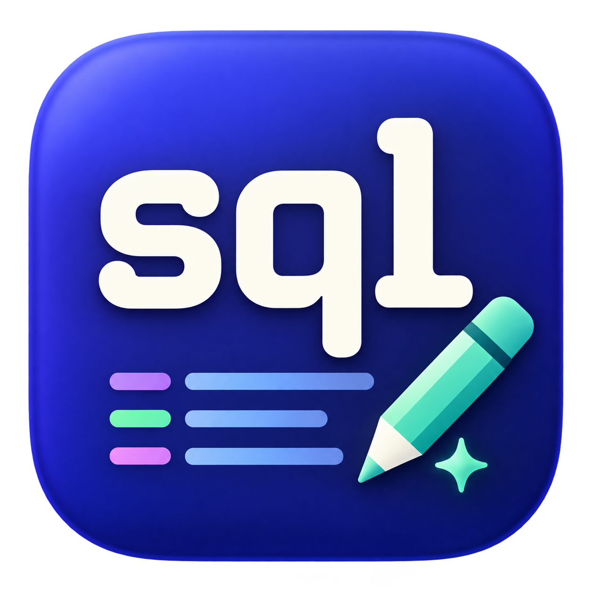
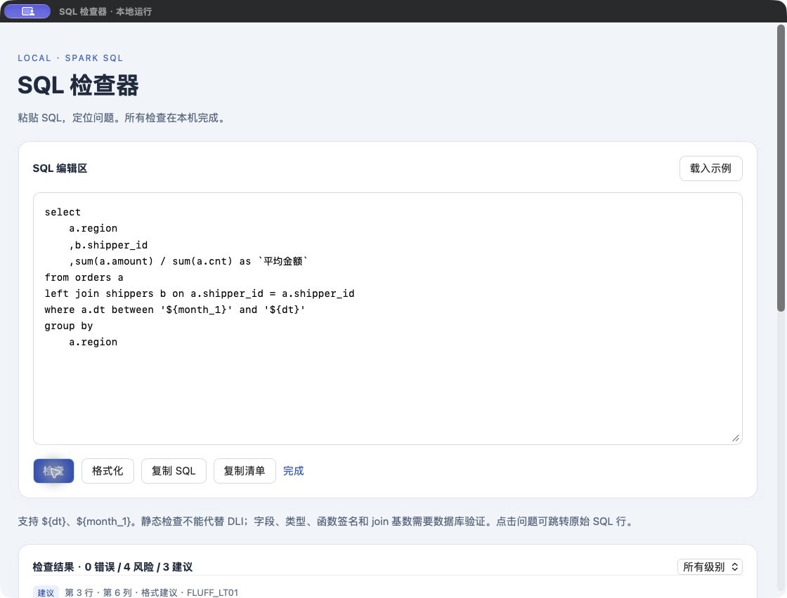

# SQL 检查器 for Mac



面向华为云 DLI / Spark SQL 的本地 SQL 检查与美化工具。直接粘贴 SQL，查看按行号定位的错误、风险和修改建议；支持小写关键字、前置逗号格式化，以及复制 SQL / 检查清单。

**SQL 在本机处理，不执行 SQL、不连接数据库、不上传或保存 SQL。**

## 下载与使用

[下载 Mac 应用 v1.0.6（Apple Silicon / M 系列）](https://github.com/arieslj/sql-checker-mac/releases/download/v1.0.6/SQL-Checker-macOS-AppleSilicon-v1.0.6.zip) · [全部 Release](https://github.com/arieslj/sql-checker-mac/releases)

解压后将「SQL 检查器.app」拖入「应用程序」，双击使用。无需安装 Python、无需终端、不需要联网。升级时先退出旧版再替换。
macOS 首次打开时可能要求确认。要求 macOS 14 或更新版本，支持 Apple Silicon 架构（包括 M1 / M2 / M3 / M4）。仅开发机器完成实机验证；Intel 和其他机器未验证。



## 检查能力

复用 [SQLGlot](https://github.com/tobymao/sqlglot) 的 Spark 解析器与 [SQLFluff](https://github.com/sqlfluff/sqlfluff) 的 sparksql 格式检查，增加保守静态规则：

| 类型 | 检查内容 |
| --- | --- |
| 确定性语法错误 | SQL 代码中的中文全角标点、group by 末尾多余逗号 |
| 解析器报错 | SQLGlot 解析失败，带行号和列号；需核对 DLI 专有语法 |
| 静态结构问题 | 当前或外层作用域未定义的表别名、on 引用后续才加入的表 |
| 高优先级关联风险 | 当前 join 表没有被 on 引用，或部分同名连接键疑似用了历史表别名 |
| 静态风险 | 两侧同字段的 join 条件、可能除零、未分组的日期区间边界 |
| 数据库验证提示 | join 连接键重复导致的潜在行数放大 |
| 高优先级聚合一致性 | 漏分组字段、缺少 group by、上下表达式不一致、非法分组表达式、隐藏分组维度 |
| 格式建议 | SQL 关键字小写、前置逗号、四空格缩进与空格 |

支持 `${dt}`、`${month_1}` 等简单模板，检查时等长替换以保留位置，格式化后恢复原文。支持 Spark 常见函数调用与中文反引号别名。未知 DLI 函数可以作为普通调用解析，但不验证函数存在性和参数类型。

**静态检查不能完全代替 DLI。** 表和字段存在性、类型、权限、函数签名、分区、连接基数和执行计划必须在数据库验证。解析成功不表示 SQL 能在 DLI 执行。

join 提示不表示已确认行数放大。除零检测只明确识别 `nullif` 防护，`case when` 等防护可能仍收到提示。支持简单表达式、输出别名和序号分组；rollup/cube/grouping sets/all、星号和歧义别名会明确提示需要验证。日期提示不能推断真实字段类型；完整 Jinja / 动态 SQL 不支持。

格式化通过词法 token、字面量、引用标识符和注释比较，拒绝结构变化或无法解析的输入。格式化后需要重新检查。单次 SQL 上限为 50,000 字符。

## 聚合与 group by 一致性

[查看最高优先级分组提示示例](mac/group-priority-preview.png)。

聚合查询中，非聚合输出必须能由分组表达式覆盖；不能简单要求两边文本逐字相同。新增最高优先级检查：

- `select area, region, sum(amount) ... group by area`：指出 region 未分组。
- `select area, sum(amount) ...`：指出混用聚合与非聚合却没有 group by。
- `select region, count(*) ... group by region + 1`：指出输出表达式不被分组表达式覆盖。
- 直接按聚合/窗口表达式分组或错误序号：优先提示。
- group by 中有未在非聚合输出体现的维度：以高优先级**粒度风险**提醒。这可以是合法 SQL，不自动删除维度。

支持完整表达式、按原始字段派生表达式、输出别名、序号、单来源限定/未限定字段、混合聚合、窗口与独立子查询作用域。别名与序号按常见 Spark 设置解析，需核对 DLI 配置与真实同名字段；按聚合输出别名分组存在歧义时标为验证风险。rollup/cube/grouping sets/all、星号和复杂相关子查询不保证完整覆盖。建议需要人工确认，不自动修改统计粒度。

[参考 Spark GROUP BY 文档](https://spark.apache.org/docs/3.5.7/sql-ref-syntax-qry-select-groupby.html)。模板变量采用等长且区分身份的临时标记，避免同长度变量被当成相同表达式；修改建议恢复原始模板。

## on 条件的别名核对

例如连接 `a6` 时，`on a6.area = a1.area and a5.region = a1.region` 会优先提示第二项，建议核对是否应改为 `a6.region = a1.region`。即使 `a5` 已定义，也会识别该模式。[查看优先处理示例](mac/join-priority-preview.png)。高优先级关联问题在清单中置顶，显示「优先处理」，复制清单也保留标记。

历史表别名可以合法参与当前 on；本工具不会一律禁止 `a5`。新规则保守检查直接 AND 等值条件中的同名连接键及共有锚点，不推断 schema，不自动改写 SQL。部分历史别名条件可能是有意的业务过滤，此时应人工确认。未限定字段、OR、复杂子查询和不明确的结构体访问不保证覆盖。这里的高优先级报错表示关联风险，不代表 SQL 语法必然不合法。

## 从源码运行网页版

需要 Python 3.9 或更新版本；推荐使用独立虚拟环境。首次安装依赖需要联网，运行时不需要。

```bash
python3 -m venv .venv
.venv/bin/python -m pip install -r requirements.txt
.venv/bin/python app.py
```

打开 http://127.0.0.1:8765 ，按 Ctrl+C 停止。也可以双击 `start.command`，或在项目目录执行 `bash start.command`。

网页版仅监听 127.0.0.1，限制 Host / 跨站 Origin，不加载 CDN、遥测或外部资源。Mac 应用通过原生桥接访问本机临时端口，并使用不持久化的 WebKit 会话。复制操作写入系统剪贴板。请勿将服务改为公网监听。

## 测试与打包

```bash
.venv/bin/python -m pytest -q
node mac/test_bridge.cjs
```

本机 87 项 Python 测试通过，覆盖检测规则、作用域、行号、模板、格式化、API 验证及轻量启动。原生通信成功/错误/超时/网页版回退、冻结进程和实际 Mac 窗口操作已验证。全部使用合成 SQL，没有读取业务数据。

[Mac 构建与打包说明](mac/README.md)。仓库附有自动测试工作流。CI 的结果以 GitHub Actions 实际运行结果为准。

## 第三方组件

SQLGlot、SQLFluff 使用 MIT 许可证；Flask、Werkzeug 使用 BSD 许可证；PyInstaller 使用 GPL 及打包产物例外许可。[第三方说明](THIRD_PARTY_NOTICES.md)。本项目暂未指定独立源码许可证。
